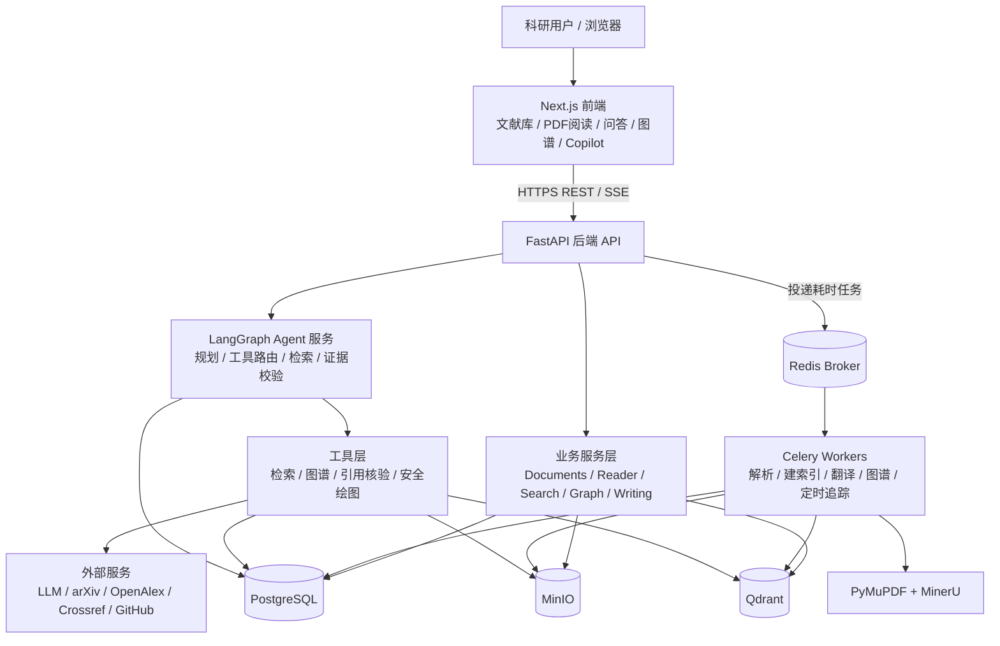
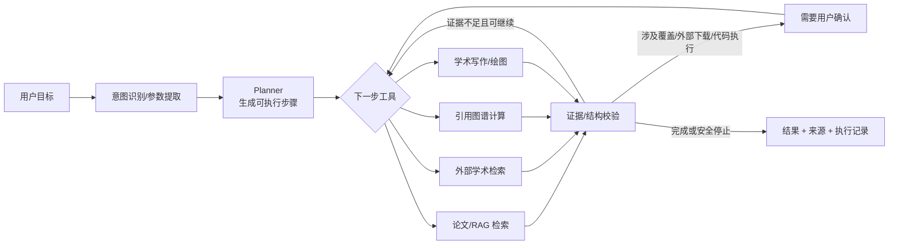
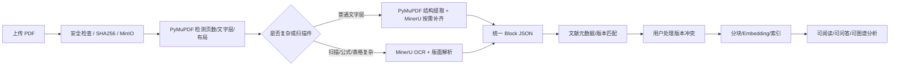

# AI 科研助手 Agent｜技术架构设计（TECH_DESIGN）

> 版本：v1.0｜日期：2026-10-29  
> 适用对象：开发 Agent / 项目开发者  
> 依据：《AI科研助手Agent_项目需求文档.md》与赛事六大模块、评测要求。  
> 定位：**一套可直接落地的技术方案，不是赛题指定的唯一技术栈。** 本文中「必须」表示为实现既定需求必须完成的能力，「选型」表示本项目采用的实现方案。

---

## 0. 结论：采用什么架构

**总体架构：模块化单体后端 + 独立异步任务 Worker + 基于 LangGraph 的有状态 Agent + 文献知识库（PostgreSQL / Qdrant / MinIO）。**

不采用一上来就拆分大量微服务，也不把所有功能塞进一个万能 Agent。六大业务模块共用论文数据模型、解析结果、源文位置锚点及知识检索服务；复杂科研任务通过 Agent 组合工具，稳定且确定性的功能通过普通后端服务完成。

### 0.1 选定技术栈（首选，不再并列多个候选）

| 层级 | 选定技术 | 用途及理由 |
|---|---|---|
| 前端语言/框架 | **TypeScript + React 19 + Next.js 16（App Router）** | 完整 Web 应用、路由、工程化、组件复用，版本在落地时锁定具体补丁版 |
| UI | **Tailwind CSS + shadcn/ui** | 快速建立统一学术风格的专业 UI |
| 前端请求/状态 | **TanStack Query + Zustand** | 服务端状态缓存与阅读器/对话侧的局部交互状态分离 |
| PDF 阅读 | **PDF.js（pdfjs-dist）** | 原始版式渲染、文本选择、页码定位、覆盖高亮、引用跳转 |
| 数学/Markdown | **KaTeX + react-markdown** | LaTeX 公式及回答内容渲染 |
| 图谱与图表 | **Cytoscape.js + Apache ECharts + Mermaid** | 引文网络、CSV 科研可视化、可编辑的流程图与架构图 |
| 后端语言/API | **Python 3.12 + FastAPI + Pydantic v2** | 文献处理与 AI 生态成熟；REST + SSE 流式响应 |
| 数据访问/迁移 | **SQLAlchemy 2 + Alembic** | 关系模型及可追踪的数据库结构变更 |
| Agent 编排 | **LangGraph（持久化 Checkpoint）** | 任务规划、状态机、工具调用、结果检查、人工确认、可恢复执行 |
| LLM | **OpenAI-compatible 统一适配器，首选 DeepSeek API** | 统一模型调用与流式输出；配置化切换服务商，**不自行训练模型** |
| Embedding | **BGE-M3** | 中英双语论文语义表示；服务端本地部署或兼容的推理 API |
| Reranker | **bge-reranker-v2-m3** | 对混合召回候选段落进行精排，提高数字/表格细节定位 |
| PDF 元素/页坐标 | **PyMuPDF** | 页数、原生文本、几何位置、文本区域、文字层判断 |
| 复杂 PDF / OCR | **MinerU 4.x** | 单双栏、扫描件、表格/公式结构化；作为独立解析 Worker 使用 |
| 论文元数据及引用 | **arXiv API / OpenAlex / Crossref + GitHub API** | 检索与入库、文献实体对齐、引用验证、复现代码判断 |
| 关系型存储 | **PostgreSQL 16+** | 用户、论文元数据、版本、引用、任务和审计记录；初期可用 16 |
| 向量/混合检索 | **Qdrant** | Dense + Sparse/BM25 混合召回、按论文过滤、RRF 融合 |
| 文件存储 | **MinIO（S3 协议）** | 原始 PDF、解析 JSON、图片/表格、译文与图表产物 |
| 缓存/消息 | **Redis** | 缓存、限流、Celery 消息代理；不作为事实数据的唯一存储 |
| 后台任务 | **Celery + Celery Beat** | 文献批量解析、Embedding、定期 arXiv 追踪、图谱构建 |
| 部署/反向代理 | **Docker Compose + Caddy** | 快速启动全套服务、自动 HTTPS、评审可访问 |
| 测试/质量 | **pytest + pytest-asyncio + Playwright + Ruff + ESLint** | API/Agent/端到端/官方样例测试与代码规范 |

**设计原则：** 尽量减少同类组件。首版不使用额外的 Elasticsearch、Neo4j、Kafka、Kubernetes 或复杂 Multi-Agent 平台：图谱使用 PostgreSQL 存关系 + NetworkX 计算 + Cytoscape.js 展示；RAG 使用 Qdrant；后台任务只用 Celery。后续数据规模增长再演进。

> 模型与解析引擎可能需要 GPU；默认通过外部大模型/Embedding API 或单独的推理节点实现，不能假设普通 Web 服务器能同时高并发运行 OCR、Embedding 和大模型。需要支持在配置中切换本地/远程解析，但远程传输 PDF 应由用户明确知悉。

---

## 1. 总体系统架构



### 1.1 边界划分

- **前端**：只负责交互、原始 PDF 渲染、结果可视化；不持有模型私钥，不做大批量 PDF 解析。
- **FastAPI**：请求认证/鉴权、参数校验、数据访问、SSE 事件和业务事务的唯一对外 API。
- **业务服务**：确定性的增删改查、版本管理、文档块定位、引用图关系查询，不要求 Agent 每次参与。
- **LangGraph**：只有遇到开放式、多步骤、需要推理/调用工具的科研任务时启动；服务端工具必须有固定 Schema。
- **Celery Worker**：负责大文件与长耗时操作；HTTP 请求快速返回 `task_id`，前端追踪进度。
- **PostgreSQL** 是元数据和关系的事实来源；**MinIO** 存原文件和产物；**Qdrant** 是可重建的检索索引。

### 1.2 系统必须保证的闭环

上传论文 → 识别版本 → 解析成可定位 Block → 分块入向量索引 → 原文阅读 → 带证据问答 → 在线检索并入库 → 引用图谱/综述 → 写作和科研绘图 → 导出结果。

---

## 2. 前端设计

### 2.1 页面与路径

| 路径 | 页面 | 核心交互 |
|---|---|---|
| `/` | 工作台 | 文献总量、最近论文、任务进度、Agent 入口 |
| `/library` | 文献库 | 单篇/批量上传、搜索、排序、版本预警、解析状态、删除 |
| `/papers/[id]` | 论文阅读器 | 左目录、中央 PDF、右侧问答/原文证据；引用往返跳转 |
| `/papers/[id]/translate` | 双语阅读 | 左原始 PDF、右对应中文块、双向同步滚动、划词翻译 |
| `/research` | Agent 科研工作台 | 任务输入、计划/工具事件、检索结果、问答、证据列表 |
| `/discover` | 文献发现 | 关键词/参考文献下钻、arXiv 订阅、推荐与点赞/点踩 |
| `/graph` | 引文图谱 | 多篇论文选择、关系图、PageRank 分析、综述、Future Work |
| `/copilot` | 写作和图表 | Idea → 论文草稿；CSV → 图表/脚本/Caption；学术翻译 |
| `/tasks` | 后台任务 | 进度、错误、重试、查看产出 |
| `/settings` | 偏好与配置 | 关注领域、语言、模型服务配置（私钥仅后端安全保存） |

### 2.2 关键组件

- `PdfViewer`：使用 PDF.js 原生渲染，渲染当前可见页及附近页面；支持 `page + bbox` 的证据矩形高亮。
- `PaperOutline`：根据后端结构化标题树定位目录。
- `CitationOverlay`：匹配文内引用区域，跳转 References 对应位置并保存返回栈。
- `BilingualReader`：基于稳定 `block_id` 对齐左右文本，滚动同步使用可见块锚点；遇到公式和表格保持原文或结构渲染。
- `AgentTimeline`：显示用户可理解的任务计划、执行工具、检索到的论文、结果和错误；**不展示模型私有推理全文**。
- `EvidenceChip`：论文、页码、定位区域、原文摘录，点击直接跳转 PDF。
- `CitationGraph`：Cytoscape.js 画节点和方向边；点击节点显示元信息、重要度、被引与引文证据。
- `AcademicChart`：ECharts 展示科研图，并提供 Python 绘图脚本/数据导出入口。

### 2.3 交互规范

- 长任务必须展示 `排队 → 正在处理 → 已完成/失败`，失败可重试；不得假装处理完成。
- 流式聊天显示增量文本；引用证据最终完成校验后展示为正式可点击结果。
- PDF 页面、翻译块、问答出处的定位规则统一，避免各模块产生多套坐标体系。
- 支持桌面宽屏优先，窗口不足时收起侧栏；要保证双语对照的可读性。

---

## 3. 后端分层与 Agent 架构

### 3.1 模块化后端

- **API Layer**：FastAPI Routers、鉴权、速率限制、SSE、统一错误码。
- **Application Layer**：DocumentService、ParsingService、RAGService、DiscoveryService、GraphService、TranslationService、WritingService、TaskService。
- **Agent Layer**：意图识别、Planner、Tool Router、Research Graph、Evidence Verifier、Answer Composer。
- **Tool Layer**：规范化的工具入参/出参，不允许 LLM 直接写 SQL、任意运行 Shell、无限制抓网页。
- **Infrastructure Layer**：PostgreSQL Repository、Qdrant Client、S3 Client、LLM Client、外部 API Client、Celery。

### 3.2 Agent 不是单次 Prompt



**Agent 节点：** `interpret_request` → `plan_steps` → `execute_tool` → `check_evidence` → `revise_or_finish` → `format_result`。LangGraph Checkpointer 保存任务状态；任务记录和结果在 PostgreSQL 中持久化。

**初版采用一个主 Agent + 专用子工作流**，而不是为了展示多 Agent 而人为拆分多个聊天角色。可以把 `literature_research`、`multi_paper_compare`、`future_work_scan` 和 `writing_assistant` 设计成独立子图，并用 Router 调用。对于重复且可确定的流程（解析、入库、画图）优先使用固定编排。

### 3.3 Tool 接口清单

| Tool 名称 | 参数示例 | 返回结果/约束 |
|---|---|---|
| `search_library` | `{query, paper_ids, top_k}` | 文献/段落候选、出处 ID |
| `get_paper_blocks` | `{version_id, page_range, block_ids}` | 精确原文内容及页面位置 |
| `search_external_papers` | `{query, source, limit}` | 真实论文元数据、来源及获取时间 |
| `resolve_reference` | `{doi/title/arxiv_id}` | 核验后的统一论文 ID、匹配分值 |
| `import_open_access_pdf` | `{source_url, paper_id}` | 合法开放下载、文件任务 ID；外网域名白名单及下载限额 |
| `get_citation_subgraph` | `{paper_ids}` | 有方向的论文节点/引用边 |
| `rank_graph_nodes` | `{graph_id, method}` | PageRank / 中心性数值和解释 |
| `find_followup_works` | `{idea, since, paper_ids}` | 后续论文和匹配证据，不能保证已穷尽全网 |
| `generate_chart` | `{artifact_id, chart_spec}` | 经过执行验证的脚本、图片、数据源 |
| `verify_academic_claim` | `{claim, evidence_ids}` | `supported / insufficient / contradicted` + 证据 |

工具需统一记录：`run_id / tool_name / normalized_args / started_at / duration / status / source_ids`。密钥和 Token 不进入 Agent 上下文和前端。

---

## 4. PDF 解析与内容版本管理（模块一）

### 4.1 解析流水线



**解析引擎选择策略：** 优先获取原生文字层及坐标；遇到扫描页、读取顺序错误、结构复杂的公式/表格时调用 MinerU（4.x 对应的 `flash / basic / standard / advanced` 档位按需求配置）。保留原 PDF 做视觉基准，不尝试通过 OCR 文本重新绘制原 PDF。

### 4.2 统一文档数据结构

解析结果必须写为自己的稳定 Schema，不让业务模块直接依赖 MinerU 的原始 JSON 字段。至少包含：

```json
{
  "paper_version_id": "uuid",
  "page_index": 2,
  "block_id": "uuid",
  "block_order": 14,
  "type": "paragraph",
  "section_path": ["3 Methods", "3.1 Training"],
  "text": "...",
  "markdown": "...",
  "latex": null,
  "bbox": [0.12, 0.24, 0.84, 0.36],
  "parser": "mineru",
  "confidence": null
}
```

- `page_index` 从 **0** 开始（UI 展示页码为 `page_index+1`）；`bbox` 统一为 `[x0,y0,x1,y1]` 的 **0～1 页面归一化坐标**。页面旋转、裁剪等由后端规范化，前端映射到 PDF.js 的 viewport。
- `block_id` 一旦发布供 RAG/翻译/引用使用，应在同一解析版本内稳定；重新解析须保留 `parse_revision` 并重新建立引用锚点映射。
- Block 类型至少支持 `title / heading / paragraph / equation / table / figure / caption / reference / appendix`。
- 表格保留 HTML/结构化单元格及来源页；公式保留 LaTeX 和原始截图；图片保存到 MinIO 并挂接所属 Block。
- 低置信度 OCR 不允许直接当作确定事实，必要时提示人工核对。

### 4.3 去重和版本识别（重点评分项）

采用**四层匹配**，不能只依赖文件名：

1. 文件 `SHA-256`：完全相同文件。
2. DOI、规范化 arXiv ID（剔除 `v1/v7` 后的作品 ID）、规范化标题+作者：同一作品的不同版本。
3. 正文清洗后的 `SimHash / MinHash`（过滤页眉页脚、参考文献可单独比较）：衡量正文重合。
4. 标题/摘要或正文向量语义相似度作为辅助，处理轻微改名、OCR 差异；对不确定的匹配要求人工确认。

库中有 `1706.03762v7`、之后上传 `v1`：识别为同一论文不同版本，提示“已有较新版本 v7，建议保留 v7”，让用户选择**保留两个版本/取消旧版导入/用新上传覆盖（需确认）**。版本对比以章节/Block 对齐后产出差异摘要，保留证据；**不自动删较新文件**。

### 4.4 超长文档与性能

- 541 页 PDF **分页/分批**处理（例如每批 10～20 页，具体由内存与模型能力调参）；每批产物持久化，可从中断位置继续。
- 按章节切块，参考起点为 400～800 tokens、重叠 50～100 tokens；公式、表格尽量作为整体，不跨章节生硬截断。
- 根据任务状态显示处理页数、已建索引块数；前端 PDF 按需渲染，检索只提取相关块，不将全书放入 LLM 上下文。
- Worker 可分别设置 CPU 解析和重型 OCR 的并发上限；避免大 PDF 占满 API 服务内存。

---

## 5. RAG 与原文定位（模块二，关键评分项）

### 5.1 索引设计

每个文本 Chunk 保留 `chunk_id / paper_id / version_id / block_ids / page_range / section_path / original_text / sparse_text / dense_vector / permission_scope`；**Qdrant 中仅放检索数据和必要元信息**，完整解析及文件归 PostgreSQL / MinIO 管理。

选定：
- Dense：**BGE-M3** 向量；
- Sparse：**Qdrant 内置 BM25 full-text 查询**（使用其要求的文本字段索引；具体客户端配置随选定的 Qdrant 版本固定）；
- 融合：**RRF**；
- 重排：**bge-reranker-v2-m3**，精排后取前若干证据块；
- 强约束：检索前按当前用户/工作空间权限、已选 `paper_ids`、可选版本过滤。

### 5.2 问答流程


**回答协议：** 每个关键事实必须附 `evidence_id`，至少可解析为论文、版本、页面、Block 和原文摘录。对数字/超参数/GPU/实验分数优先使用原文精确片段而非模糊语义推断；对缺失的数值回答“未在所选文献中找到可靠依据”。

**验证机制：** 证据 ID 是否属于本次检索范围、是否对应真实 Block、原文摘录与引用位置是否一致；LLM 将关键论断与证据 ID 绑定，再做支持性检查。自动校验不保证绝对消除幻觉，应在测试报告中度量引用准确率和无证据回答率。

**多文比较：** 强制每篇选中文献先召回独立证据，再构造“比较维度 × 论文”的中间表；最后综合生成比较结果；信息缺失写 `未报告/无充分证据`，不凭模型记忆补全。

---

## 6. 阅读器与双向翻译（模块三）

### 6.1 阅读器

- 原版 PDF.js 画布与文字层为左侧基准，不使用 Markdown 替代原论文渲染。
- 目录来自统一 Block JSON 的 heading tree。
- 正文 `[11]` → Reference Block：优先使用解析出的引用标记/参考文献编号映射与坐标；无法解析时在 UI 提示，不产生假链接。
- Reference → 原文引用处：维护反向引用索引（一个 reference 可被多处引用），展示列表或回到最近一次来源。

### 6.2 双语阅读

采用“**原版 PDF + 右侧译文 HTML/Markdown**”的首版实现：按 Block 翻译（只翻译自然语言，公式/代码保持原样），保存 `block_id -> translated_text`。以段落可见区域作为同步锚点，并支持关闭双向联动。图片和表格可在右侧按结构展示或跳转原图。

> 原位替换英文排版生成全新 PDF 是高难选项，不应代替首版的稳定对照阅读。赛题允许 Markdown/HTML 翻译输出；在满足对照与同步后，再扩展排版保留型 PDF 导出。

---

## 7. 论文检索、追踪和推荐（模块四）

**来源策略：**
1. arXiv：按标题/arXiv ID/关键词检索，获取预印本和版本信息；可使用公开 API / OAI-PMH 收集最新条目。
2. OpenAlex：统一论文身份、查找 `referenced_works` 和相关工作；Crossref 补充 DOI 与正式出版元数据。
3. GitHub API：从论文正文或元数据中提取 GitHub 项目，并校验仓库是否可访问。**有链接不等于真实可复现**；推荐理由标明代码仓库存在与否、依赖/README 可用性等证据。
4. 只在合法、可公开获取时自动下载 PDF。遇到付费墙或链接失效，仅保存元数据并标注无法下载。

**推荐分数（初版可解释的启发式，不宣称是训练好的推荐模型）：**
`推荐分数 = 主题语义相关性 + 文献库关联 + 近期程度 + 开源代码可用性 + 用户反馈`，各项归一化后调权，输出每项得分及原因。参考文献下钻优先筛选与核心方法/基线/数据集有关的引用，必要时使用原文引用上下文说明关联度。

**定时任务：** Celery Beat 每日/每周拉取用户订阅方向、对外部 API 限流重试、去重入库、生成新的推荐列表；不得将抓取程序与前端会话绑定。

---

## 8. 引用图谱、综述、Future Work（模块五）

### 8.1 数据来源与图结构

`Paper → cites → Paper` 是有向边。优先使用 OpenAlex 已解析的引用 ID；对用户上传 PDF 的 References，解析作者/标题/年份/DOI，调用 Crossref/OpenAlex 匹配，保留 `match_confidence` 和 `provenance`；**不能根据 LLM 自己认为某论文引用过另一论文来建边**。

PostgreSQL 存节点身份及引用边；NetworkX 加载当前选择的子图计算 `PageRank / in-degree / betweenness`。Cytoscape.js 展示 **约 20 篇论文** 的局部网络；区分“本地上传论文”与“外部未入库论文”。排序时显示具体指标和算法，不把 PageRank 绝对等同于科研质量。

### 8.2 综述与创新点

- 基于**实际已选择论文**的摘要、方法、实验结论与引用关系生成有出处的领域综述。
- 提取 Future Work 所在 Block，结构化成 `研究问题 / 论文时间 / 原始证据 / 相关后续工作`。
- 对每项候选，通过 OpenAlex/arXiv 检索发表时间更晚的相关工作，尝试判定 `已有后续进展 / 可能仍开放 / 证据不足`。
- 只能输出“经当前检索暂未发现明确解决证据”，不能声称“世界上从未有人做过”。

---

## 9. 写作 Copilot 与安全执行（模块六）

### 9.1 写作

用户输入科研 Idea → Agent 检索相关真实论文 → 生成可编辑 `Abstract / Introduction / Related Work / References` → 校验引用（标题/DOI/arXiv ID/OpenAlex ID）→ 导出 Markdown（可逐步扩展 LaTeX）。未核验的文献不得进入最终 References。

### 9.2 数据可视化

上传 CSV → Pandas 检查数据列/类型/缺失值 → LLM 生成**图形规范**（图种、轴、分组、单位、标题和信息要点）→ 使用受控的 `Matplotlib`/`ECharts` 绘制 → 输出 PNG/SVG、绘图脚本、原始数据文件引用和 Figure Caption。图注中的数值及趋势必须从实际数据计算，禁止编造。

- Mermaid / Graphviz：生成脚本后解析/渲染测试，失败时反馈修正。
- TikZ：可生成 `.tex`；如启用编译必须运行在隔离容器内，关闭危险权限，并限制 CPU/内存/时间。
- **禁止把 LLM 生成的任意 Python/Shell 代码直接交给主 API 容器运行。** 首版采用固定绘图函数/白名单图形 API；扩展任意代码执行时需独立沙箱容器、无网络、只读基础镜像、资源限额和人工确认。

---

## 10. 数据库和存储架构

### 10.1 PostgreSQL 核心表（名称可依编码规范调整）

| 表 | 必要字段/含义 |
|---|---|
| `users` | `id, email, password_hash/oidc_id, created_at`；演示可先启用单用户模式，但接口保留 `user_id` |
| `papers` | 逻辑论文身份：`id, title, authors_json, abstract, doi, arxiv_id, openalex_id, year` |
| `paper_versions` | `id, paper_id, version_label, file_key, file_sha256, source_url, page_count, parse_status, parse_revision` |
| `document_blocks` | `id, version_id, page_index, order, type, text, markdown, latex, bbox_json, section_path_json` |
| `document_chunks` | `id, version_id, block_ids_json, page_start, page_end, qdrant_point_id, tokenizer_version` |
| `paper_references` | `id, source_paper_id, ref_no, raw_citation, matched_paper_id, confidence, source_block_id` |
| `citation_edges` | `id, citing_paper_id, cited_paper_id, source, confidence, verified_at` |
| `paper_collections` / `collection_items` | 用户选择的一批论文；用于多篇问答、图谱和综述 |
| `translations` | `version_id, block_id, target_lang, translated_text, model, status` |
| `agent_runs` / `tool_calls` | 对话、任务状态、计划、调用、来源和失败原因（与 Checkpoint 关联） |
| `background_tasks` | `id, type, progress, status, result_ref, error, retries, created_at` |
| `recommendations` / `feedback` | 推荐分数、解释项、用户反馈 |
| `artifacts` | 图表、代码脚本、草稿、综述等输出文件索引，MinIO object key |

**关键数据一致性：** `papers` 是逻辑论文，`paper_versions` 是某个上传或下载版本；删除一个版本时同步撤销该版本 Chunk 的 Qdrant 索引，不应误删其他版本；如果保留最新版本为默认阅读版本，应明确指定 `preferred_version_id`。

### 10.2 存储职责

- **PostgreSQL**：所有元数据、关系图边、索引映射、任务审计、最终状态。
- **MinIO**：PDF 原件、MinerU 原始结果、结构化快照、图像、翻译和可下载附件。
- **Qdrant**：检索用的向量/全文索引，能基于 PostgreSQL 和 MinIO 重新构建。
- **Redis**：短期缓存及任务 Broker；长期任务结果必须落 PostgreSQL。

### 10.3 论文元数据去重主键优先级

`DOI / 规范化 arXiv ID / OpenAlex Work ID / 标题-作者模糊匹配`，不同来源可能冲突，保存 `source_provenance` 并支持人工纠正。不把不同 arXiv 版本创建成毫无关联的多个逻辑作品。

---

## 11. 核心 API 约定

采用 `/api/v1` 前缀、REST 风格及 JSON 响应；文件通过 `multipart/form-data` 上传，流式事件使用 SSE。以下为需首先稳定的接口契约：

| 方法/路径 | 功能 | 响应关键字段 |
|---|---|---|
| `POST /api/v1/papers/upload` | 单/批量上传 | `paper_ids, version_ids, task_ids, conflicts` |
| `GET /api/v1/papers` | 文献列表/筛选 | `items, total` |
| `GET /api/v1/papers/{id}` | 论文元数据及版本 | `paper, versions` |
| `GET /api/v1/versions/{id}/blocks` | 解析结果/目录/位置 | `blocks, outline` |
| `GET /api/v1/versions/{id}/file` | 授权访问原 PDF | `signed_url` 或流式代理 |
| `POST /api/v1/versions/conflicts/{id}/resolve` | 用户处理去重/版本冲突 | `resolution, preferred_version_id` |
| `POST /api/v1/chat/runs` | 发起单篇/多篇 RAG 或 Agent 问答 | `run_id` |
| `GET /api/v1/chat/runs/{id}/events` | SSE 流式回答/工具步骤 | `event, data, sequence` |
| `POST /api/v1/translate` | 局部/全文块翻译 | `task_id` 或 `translations` |
| `POST /api/v1/discovery/search` | 联网论文检索 | `papers, provenance` |
| `POST /api/v1/discovery/import` | 引入所选论文 | `task_id` |
| `GET /api/v1/recommendations` | 推荐列表/理由 | `items, scoring_factors` |
| `POST /api/v1/recommendations/{id}/feedback` | 点赞/踩 | `feedback_id` |
| `POST /api/v1/graphs` | 构建引用子图 | `task_id/graph_id` |
| `GET /api/v1/graphs/{id}` | 获取节点/边/指标 | `nodes, edges, metrics` |
| `POST /api/v1/research/synthesize` | 综述与 Future Work | `run_id` |
| `POST /api/v1/copilot/draft` | Idea → 论文框架 | `run_id` |
| `POST /api/v1/copilot/charts` | CSV → 规范/脚本/图表 | `task_id` |
| `GET /api/v1/tasks/{id}` | 查询后台任务进度 | `status, progress, error, result` |
| `POST /api/v1/tasks/{id}/retry` | 失败任务重试 | `new_task_id` |

**统一证据对象（所有问答/综述复用）：**

```json
{
  "evidence_id": "uuid",
  "paper_id": "uuid",
  "paper_version_id": "uuid",
  "block_id": "uuid",
  "page_index": 2,
  "bbox": [0.12, 0.24, 0.84, 0.36],
  "quote": "exact source excerpt",
  "file_url": null
}
```

API 鉴权后读取文件；`file_url` 可由服务端短期签名，**不能将存储桶永久公开**。失败响应规范化为 `code/message/details/request_id`。任务 SSE 至少分 `plan / tool_started / tool_finished / evidence / token / completed / failed`；重连可按 `sequence` 补取事件，避免刷新就丢状态。

---

## 12. 项目目录结构（建议直接按此建立）

```text
ai-research-agent/
├── apps/
│   └── web/                     # Next.js / TypeScript
│       ├── src/app/              # 路由页面
│       ├── src/components/       # PDF / Agent / Graph / Chart 组件
│       ├── src/features/         # library / reader / research / copilot
│       ├── src/lib/              # API client / SSE / types / utils
│       └── package.json
├── services/
│   └── api/                     # FastAPI / Python
│       ├── app/main.py
│       ├── app/api/v1/           # Router
│       ├── app/core/             # config / auth / errors
│       ├── app/models/           # SQLAlchemy
│       ├── app/schemas/          # Pydantic API 契约
│       ├── app/repositories/     # DB 操作
│       ├── app/services/         # 业务模块
│       ├── app/agents/           # LangGraph 状态图/提示词
│       ├── app/tools/            # 受控工具函数
│       ├── app/parsers/          # PyMuPDF / MinerU adapter
│       ├── app/retrieval/        # Chunking / Qdrant / Rerank
│       ├── app/integrations/     # arXiv / OpenAlex / GitHub / LLM
│       ├── app/tasks/            # Celery / Beat 定时任务
│       └── tests/
├── packages/
│   └── contracts/               # OpenAPI 生成的 TypeScript 类型
├── infra/
│   ├── compose.yml              # web/api/worker/beat/db/qdrant/minio/redis/caddy
│   ├── Caddyfile
│   └── env.example
├── scripts/                      # 初始化 / 导入样例 / 评测脚本
├── docs/
│   ├── REQUIREMENTS.md
│   ├── TECH_DESIGN.md
│   └── EVALUATION.md
├── .github/workflows/ci.yml
└── README.md
```

**协作约束**：后端先定义 OpenAPI/Pydantic 契约，再生成 TypeScript Client，避免前后端自己猜字段。AI 工具返回统一 Schema，不允许只返回任意格式自然语言。任何新业务模块必须写对应的 API 测试和至少一条 E2E 路径。

---

## 13. 部署、可靠性和安全性

### 13.1 部署拓扑

- 一个公网域名由 Caddy 代理：`/` → Next.js，`/api` → FastAPI。仅 Caddy 对公网暴露 80/443；PostgreSQL、Qdrant、Redis、MinIO 处于 Docker 内网。
- Docker Compose 服务：`web, api, worker-cpu, worker-parser, beat, postgres, qdrant, minio, redis, caddy`；解析重任务可通过独立宿主机/GPU Worker 接入同一 Redis/MinIO。
- 静态的演示数据和标准测试 PDF 按脚本导入；容器启动后由 migrations 初始化数据库，配置通过 `.env` 提供（仓库只放 `.env.example`）。
- CI：ESLint / Ruff / pytest / 前端构建 / 关键 E2E；评审环境用锁定依赖与 Docker 运行。

### 13.2 可靠性

- 文件上传限制大小与格式，校验 PDF magic bytes 和文件完整性；扫描件和 541 页文档任务设置可恢复检查点。
- 任务幂等：同一 `file_sha256 + parser_revision` 不应重复建索引；Celery 失败支持重试和错误日志；有进度与超时机制。
- 外部 API 统一限速、指数退避、缓存、来源保留；API 不可用时明确降级为本地知识库功能。
- 设置任务并发/内存配额、PDF 按页流式处理、Qdrant 批量写入，避免大文档导致全站不可用。
- 记录 Agent 计划、调用、证据 ID 和模型参数（脱敏），用于现场答辩和错误复现。

### 13.3 安全

- 服务端密钥只放环境变量/密钥管理，浏览器及 Git 历史不得含 API Key。
- 最少需要演示账号的鉴权与各论文数据的所有者校验，避免跨用户读取 PDF。
- PDF、CSV、用户输入与外部网页都属于**不可信内容**；防 Prompt Injection，不允许文档正文改变工具权限或系统规则。
- 外网下载做 URL 域名/地址校验、禁止内网地址和重定向 SSRF，限定文件体积、请求超时；严禁自动抓取受限文献。
- CSV 图表不得执行含任意代码的公式/文件内容；禁用主容器中的任意代码运行。
- 跨用户文献与缓存隔离，引用/权限检查在工具层完成，不只靠前端隐藏。

---

## 14. 官方测试验收与质量指标

| 测试用例 | 操作 | 必须看到的结果 |
|---|---|---|
| v7/v1 版本去重 | 上传 `1706.03762v7.pdf`，再上传 `v1` | 基于正文内容及版本信息提示关联；能区分新旧，保留用户决策 |
| 双栏矢量 PDF | 上传 `1706.03762v1.pdf` | 标题树、文本阅读顺序、公式/表格/参考文献可用，证据可定位 |
| 扫描件 OCR | 上传 `1706.03762v1_img.pdf` | 有无文字层均可继续解析，能够检索关键正文 |
| 541 页教材 | 上传 `UnderstandingDeepLearning_02_09_26_C.pdf` | 能分批处理、索引、展示进度并就相关章节提问；不崩溃 |
| 单篇精确 RAG | 问超参数/GPU/实验指标 | 回答关键事实并附定位准确的 PDF 证据；无证据不猜 |
| 多篇推理 | 选择 Transformer/BERT 或 GPT 系列 | 能分论文引用证据并做维度对比 |
| PDF 阅读/翻译 | 用双栏论文阅读 | 目录跳转、参考文献往返、局部翻译、双语对照同步滚动 |
| 文献检索 | 输入论文标题或引用条目 | 真实检索元数据，合法下载后进入文献库并去重 |
| 推荐/追踪 | 订阅一个研究主题 | 定时产出有解释的推荐，代码可用性可核查，可点赞/点踩 |
| 引文图谱 | 导入约 20 篇相关论文 | 引用方向正确，PageRank 排名可解释，能生成有证据综述与候选 Future Work |
| 学术写作 | 输入 Idea | 论文框架可编辑，References 可在 DOI/arXiv/OpenAlex 核验 |
| CSV 绘图 | 上传样例 CSV | 数据可视化、脚本和图注齐全；数值与 CSV 一致 |

**需要实现自动化评测**：
- `解析准确性`：抽样对比标题/公式/表格/参考文献解析是否正确；记录长文档失败页比例。
- `RAG 回答正确性`：固定题集中的事实准确率、证据定位正确率、无证据时拒答率。
- `图谱边准确性`：人工抽取边并检查实际出处及文献身份匹配。
- `健壮性`：中断续传、外部 API 失败/限流、重复上传、任务重试、错误页面、多人数据隔离。

指标阈值应通过官方数据集基线跑出来后设置；**不凭空宣称 99% 解析准确率或零幻觉**。

---

## 15. 开发阶段与依赖关系

> 为满足 2026-11-18 省赛提交节点，优先打通官方样例可演示的闭环。**六大模块均属于目标需求，分期只是开发顺序，不意味着允许永久缺失。**

### P0｜基础平台与可信问答（首先完成）
1. Monorepo、Compose、PostgreSQL、MinIO、Qdrant、Redis 与统一 API 契约。
2. PDF 上传、PyMuPDF/MinerU 解析、统一 Block 和坐标、目录树。
3. 论文与版本模型，v1/v7 去重预警及决策界面。
4. BGE-M3 + Qdrant 混合检索 + Reranker，单篇 RAG 与 PDF 可点击证据。
5. 扫描件、541 页教材解析与后台任务的稳定性验证。

### P1｜Agent 和科研发现
1. LangGraph 规划、工具调用、执行时间线与验证节点；多篇 RAG。
2. arXiv/OpenAlex/Crossref 检索、PDF 导入与 GitHub 代码检查。
3. 引用图谱、NetworkX PageRank 和初步综述。

### P2｜阅读交互与科研创新
1. PDF 引用双向跳转、块级中英翻译与同步滚动。
2. 定时追踪、个性化推荐和反馈。
3. Future Work 抽取、后续研究核验与候选科研方向。

### P3｜写作、评测和交付完善
1. Idea 论文框架、真实 References 核查；CSV → Matplotlib/ECharts + Figure Caption。
2. Mermaid/Graphviz/TikZ 脚本及语法/渲染验证。
3. 完成 5～8 分钟演示视频、30 页以内技术 PDF、README、公开仓库、在线演示地址。

**尽早并行开发的关键点**：文献 Block Schema、证据锚点、API 契约必须在第一个工作阶段确定；后续五个模块都依赖它们。不要先把页面写完再补后端证据结构。

---

## 16. 给编码 Agent 的执行约束

1. 实现时以 `REQUIREMENTS.md` 为需求依据，以本 `TECH_DESIGN.md` 为架构依据；两者冲突时先报告差异，不擅自删减赛题功能。
2. 以**模块化单体**与**单主 Agent + 专用工作流**实施，不擅自引入不在架构中列出的第二套数据库、Agent 框架或前端 UI 框架。
3. 后端统一 `papers / paper_versions / document_blocks / evidence` 数据语义；所有引用位置必须真正可跳转到原 PDF。
4. 外部 LLM/OCR/Embedding 服务必须经 Adapter，配置化、可替换；任何硬编码 API Key 均禁止。
5. 所有耗时任务通过 Celery，支持状态和失败处理；所有开放式 Agent 步骤必须有工具实际执行日志及证据校验。
6. 对不确定科研事实明确标注“证据不足”，不得生成假 DOI、假 References、假图谱边或根据未运行的代码伪造图表。
7. 优先保证官方测试用例跑通与最终可公网演示，再优化高级 UI 和拓展功能。
8. 每完成一项功能，交付可运行代码、测试、验证结果和对应的文档更新，不只生成占位页面。

---

## 17. 选型依据与参考（截至 2026-10-29）

下列链接支持关键技术的可行性；**这是工程选型依据，不是赛事官方唯一规定**。实际安装时选择兼容的正式版并提交 lockfile：

- Next.js App Router：https://nextjs.org/docs/app
- LangGraph Python：https://reference.langchain.com/python/langgraph/overview
- MinerU 官方项目：https://github.com/opendatalab/MinerU
- MinerU 4.x 快速开始：https://github.com/opendatalab/MinerU/blob/master/docs/en/quick_start/index.md
- PDF.js：https://github.com/mozilla/pdf.js
- Qdrant Hybrid Query：https://qdrant.tech/documentation/search/hybrid-queries/
- OpenAlex API：https://help.openalex.org/api/
- OpenAlex 引用关系：https://help.openalex.org/how-to/api-recipes/
- Celery 稳定版文档：https://docs.celeryq.dev/en/stable/

